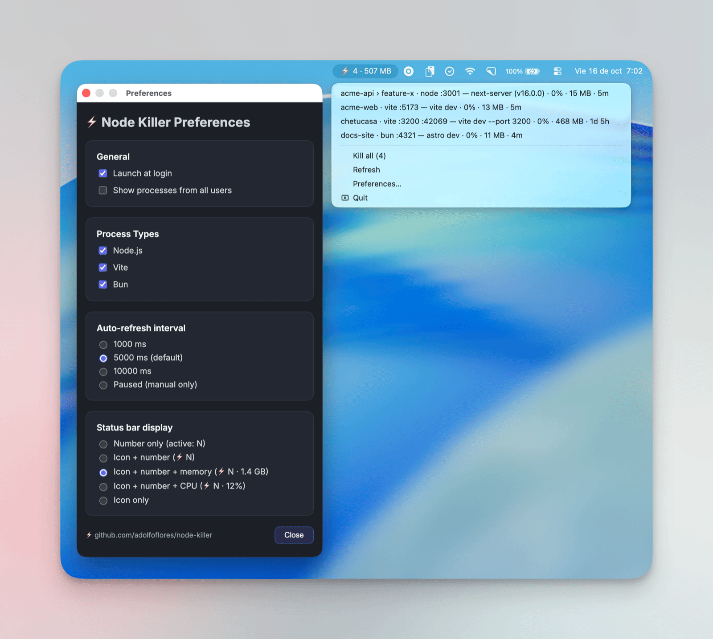

# ⚡️ Node Killer

[](https://www.electronjs.org/)
[](https://developer.apple.com/macos/)
[](./LICENSE)

⚡️ **Node Killer** — a sleek macOS menubar app that keeps an eye on your **Node.js**, **Vite**, and **Bun** dev servers and lets you kill them with a click.

> 🖥️ Currently available only for Apple Silicon (arm64).



## ✨ Features
- 📊 **Live counter** in the status bar — shows how many dev servers (Node.js, Vite, Bun) are listening (`active: 4`), optionally with their total memory or CPU (`⚡️ 4 · 1.4 GB`).  
- 🖱️ **Interactive tray menu** — lists every dev server sorted by project (git repo or worktree), with its ports, command, CPU, memory, and uptime (`my-app › feature-x · vite :5173 — vite dev · 3% · 120 MB · 2h`). Memory matches Activity Monitor.  
- 🔪 **One-click kill** — stops a dev server together with the tool that started it (npm, next dev, …) and its workers, like Ctrl-C, with success/error notifications.  
- 💣 **Kill all** — stops every listed server at once, with confirmation and a summary.  
- 🔄 **Auto-refresh** — every 5 seconds by default (1 s, 10 s, or paused), plus a manual **Refresh** option.  
- 🧰 **Preferences** — refresh rate, launch at login, status-bar display mode, processes from all users, and which process types to monitor (Node.js, Vite, Bun).


## 🚀 Getting Started

For development:

```bash
npm install
npm run dev
```

Node Killer lives in the macOS menu bar near the clock. 


## 📥 Download

You can grab the latest pre-built binary from the [Releases page](https://github.com/adolfoflores/node-killer/releases).

👉 Download for Apple Silicon (M1/M2/M3/M4):  
[Latest release](https://github.com/adolfoflores/node-killer/releases/latest) (grab the `.dmg`)

> 🖥️ Currently only Apple Silicon (arm64) builds are provided.  
> The app isn't notarized, so macOS blocks the first launch: open **System Settings → Privacy & Security** and click **Open Anyway**.  

## 📦 Build

Create a `.app` and `.dmg` bundle with [electron-builder](https://www.electron.build/):

```bash
npm run build
```

Artifacts are written to `dist/`. 

To build and install it straight into `/Applications` (a local build opens without the Gatekeeper prompt):

```bash
npm run install:local
```


## ⚠️ Limitations
- Only processes listening on a TCP port are shown (found with `lsof -nP -iTCP -sTCP:LISTEN`); scripts, watchers, or test runners without a port aren't listed.
- Servers running inside Docker containers aren't shown: on the Mac they appear as Docker's own processes, not as `node`.
- The Ctrl-C style kill recognizes common dev tools (npm, npx, pnpm, yarn, bun run, next, nuxt, astro, remix, vite, nodemon, tsx). With other runners, such as `turbo` or `concurrently`, only the server and its workers are stopped, and the runner may start it again.

## 📸 Roadmap
- [x] Vite and Bun support
- [x] Ports, command, CPU, memory, and uptime for each server
- [x] Memory and CPU totals in the status bar
- [x] Ctrl-C style kill (stops the dev tool that started the server)
- [x] Project and git worktree names in the menu
- [ ] Basic Linux support


## 🧪 Manual Smoke Test
1. Start one server for each runtime you use (`next dev`, `vite dev`, `bun dev`, etc.).
2. Run `npm run dev` for Node Killer.
3. Confirm the menu shows each process with its project, the correct label (node/vite/bun) and ports, and that disabling a type in Preferences hides its entries.
4. Terminate a server started with `npm run dev`: the whole command should stop and its terminal return to the prompt. Then try **Kill all** and review the notifications.


## 🤝 Contributing
Pull requests and feedback are welcome! Feel free to open an issue. Run `npm test` before opening a PR.

## 📝 License
[MIT](./LICENSE)

